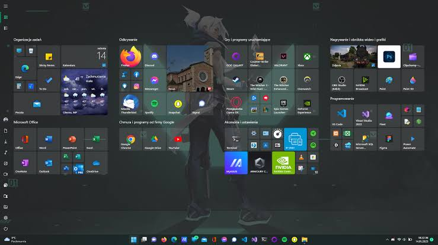
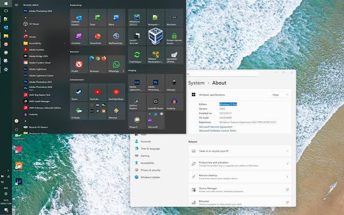

# ExplorerPatcher Customizes the Windows Desktop Shell

ExplorerPatcher is an open-source Windows utility for changing taskbar, Start menu, File Explorer, system tray, and window-switching behavior.

It restores familiar shell options while keeping individual features configurable. Users can combine an explorerpatcher classic taskbar layout with selected Windows 11 interface elements instead of replacing the entire desktop environment.

## Features

ExplorerPatcher focuses on practical Windows shell customization:

- Select supported taskbar implementations and behaviors.
- Control taskbar alignment, grouping, labels, and icon presentation.
- Configure explorerpatcher start menu positioning and appearance.
- Restore selected classic context-menu and File Explorer behavior.
- Choose between supported Alt+Tab window switchers.
- Adjust system tray, clock, network, and notification-area options.
- Apply multi-monitor taskbar preferences.
- Restart File Explorer after changing shell settings.
- Check for compatible application updates.
- Remove the utility through its properties interface or setup program.

| Shell area | Typical customization | Expected scope |
| --- | --- | --- |
| Taskbar | Style, labels, grouping, alignment, position | Windows desktop shell |
| Start menu | Style, placement, app behavior | Start experience |
| File Explorer | Command bar and context-menu preferences | Folder windows and desktop |
| Alt+Tab | Modern, Windows 10, or classic switcher | Window switching |
| System tray | Clock and flyout behavior | Notification area |
| Updates | Release checks and update preferences | ExplorerPatcher components |

The explorerpatcher taskbar settings are designed for users who want familiar controls without relying on a collection of unrelated registry scripts.



## Taskbar Customization

The taskbar section is the center of the ExplorerPatcher experience.

Depending on the Windows build and ExplorerPatcher version, available options can include:

- Windows 10-style or supported Windows 11 taskbar behavior.
- Visible labels and taskbar-button grouping preferences.
- Primary and secondary monitor configuration.
- Taskbar alignment and icon sizing.
- Search, task view, widgets, and desktop-button visibility.
- Clock and notification-area refinements.

An explorerpatcher classic taskbar configuration can make open windows easier to distinguish when labels and separate buttons are preferred.

Compatibility varies with Windows cumulative updates because the shell components being adjusted can change between builds.

## Start Menu

[](https://explorerpatcher-classic-taskbar.github.io/explorerpatcher-start-menu/)

The explorerpatcher start menu controls complement the taskbar without requiring every shell feature to use the same visual generation.

Users can review options for:

- Start menu style.
- Screen position and alignment.
- Application-list behavior.
- Recommended content visibility.
- Menu opening behavior.
- Integration with taskbar positioning.

The available styles depend on the installed Windows build. A setting that works on one release may be unavailable after Microsoft changes the underlying shell.



## File Explorer

ExplorerPatcher can alter selected Explorer presentation and interaction choices.

The explorerpatcher file explorer area may include classic context menus, command-bar preferences, navigation behavior, and other shell refinements exposed by the current release.

These changes should be evaluated separately from taskbar options:

1. Apply one category of changes at a time.
2. Restart File Explorer when prompted.
3. Confirm desktop and folder-window behavior.
4. Revert the latest setting if Explorer becomes unstable.
5. Keep a verified setup executable available for recovery.

Shell customization is sensitive to operating-system updates, preview builds, third-party themes, and other programs that modify `explorer.exe`.

## Alt+Tab Window Switching

The explorerpatcher alt tab feature supports alternate window-switching experiences where compatible.

The supplied source includes a dedicated Windows 7-style switcher component. Its main hook and presentation behavior are implemented in [main.c](ep_extra_valinet.win7alttab/main.c).

Associated interface resources are defined in [Resource.rc](ep_extra_valinet.win7alttab/Resource.rc) and [resource.h](ep_extra_valinet.win7alttab/resource.h).

The Visual C++ project definition is stored in [ep_extra_valinet.win7alttab.vcxproj](ep_extra_valinet.win7alttab/ep_extra_valinet.win7alttab.vcxproj).

This component interacts with Windows shell internals, themes, and live previews. Results can therefore differ across Windows builds and graphics configurations.

## Technical Details

ExplorerPatcher is primarily a native Windows project.

The available source set is coordinated by [ExplorerPatcher.sln](ExplorerPatcher.sln), while [version.h](version.h) defines the four-part product and file version used by the build.

The included version metadata identifies the supplied snapshot as `26100.8457.70.4`.

| Source component | Purpose |
| --- | --- |
| Solution | Coordinates Visual Studio projects |
| Setup patch helper | Examines and updates setup-related binary data |
| Extra loader | Discovers and initializes optional extension libraries |
| Alt+Tab module | Supplies classic window-switcher behavior |
| Release-name tool | Prints a release name from version resources |
| Build scripts | Prepare dependencies for supported architectures |

The source interacts with documented and undocumented parts of the Windows shell. Developers should expect behavior to depend on precise structures, exported functions, and operating-system versions.

## Source Code

### Setup Patch Helper

The setup patching logic is implemented in [ep_setup_patch.c](ep_setup_patch/ep_setup_patch.c).

It opens supplied modules and setup files, computes file data, and performs guarded binary operations.

Its project configuration is defined by [ep_setup_patch.vcxproj](ep_setup_patch/ep_setup_patch.vcxproj).

This helper expects command-line arguments intended for the surrounding build or release process. It should not be treated as a general-purpose end-user patching command.

### Release Naming

[ep_generate_release_name.c](ep_generate_release_name/ep_generate_release_name.c) reads version information from the executable resources and prints a dotted release identifier.

The build definition for that helper is [ep_generate_release_name.vcxproj](ep_generate_release_name/ep_generate_release_name.vcxproj).

This keeps generated artifact names aligned with the version resources instead of duplicating the release number in automation.

### Extension Loader

Optional extension discovery and initialization are handled by [worker.c](ep_extra/worker.c).

The loader searches the Windows directory for matching `ep_extra_*.dll` libraries, resolves their setup entry points, and coordinates cleanup.

A small assembly entry point in [main.asm](ep_extra/main.asm) transfers execution to the worker routine.

Windows resource metadata is stored in [ep_extra.rc](ep_extra/ep_extra.rc), with identifiers declared by [resource.h](ep_extra/resource.h).

The module is compiled through [ep_extra.vcxproj](ep_extra/ep_extra.vcxproj).

## Build Configuration

The supplied build scripts prepare zlib dependencies for x64 and ARM64 configurations.

[BuildDependenciesDebug.bat](BuildDependenciesDebug.bat) requests debug libraries, while [BuildDependenciesRelease.bat](BuildDependenciesRelease.bat) prepares release libraries.

From a Visual Studio developer command environment, the dependency stage follows this form:

```bat
BuildDependenciesRelease.bat
msbuild ExplorerPatcher.sln /p:Configuration=Release /p:Platform=x64
```

These commands describe the build workflow. They require the complete repository, compatible Visual Studio tools, CMake, submodules, and platform dependencies.

The local source selection may not contain every submodule referenced by the full solution.

## Updating

ExplorerPatcher provides update controls through its Properties interface.

Before applying an update:

- Read the release notes for Windows-build compatibility.
- Confirm whether the release is stable or marked as a prerelease.
- Keep a copy of the setup executable from the official repository.
- Record important shell preferences.
- Temporarily disable conflicting shell customization tools.
- Allow Explorer to restart when the update finishes.

A Windows update can require a newer ExplorerPatcher release even if the existing configuration previously worked.

## Uninstalling

The official setup program exposes a confirmed uninstall switch:

```powershell
.\ep_setup.exe /uninstall
```

The same operation can be started from the ExplorerPatcher Properties interface or the Windows installed-app management interface.

The official documentation also supports renaming the setup program to `ep_uninstall.exe` and running it.

Uninstallation normally restarts the Windows shell. Save open work before beginning.

## Verifying a Download

Use the official GitHub release page as the distribution source.

PowerShell can calculate a downloaded setup file's SHA-256 value:

```powershell
Get-FileHash .\ep_setup.exe -Algorithm SHA256
Get-AuthenticodeSignature .\ep_setup.exe
```

These are Windows PowerShell verification commands, not ExplorerPatcher commands.

Compare hashes only with a value published by a source you already trust. A matching filename alone does not establish authenticity.

## Compatibility

ExplorerPatcher behavior is tied closely to Windows shell versions.

| Environment | Guidance |
| --- | --- |
| Stable Windows release | Use a compatible stable ExplorerPatcher build |
| Windows preview channel | Expect unsupported changes and regressions |
| ARM64 device | Select the ARM64 setup artifact |
| Multiple shell modifiers | Test for overlapping hooks and settings |
| Managed computer | Confirm organizational policy before modifying |
| Major Windows update | Review compatibility before updating the OS |

Some settings may disappear when Microsoft removes the corresponding implementation from Windows.

Security software can also flag shell injection or patching behavior because these techniques resemble behavior used by other low-level programs. Obtain binaries only from the official repository and evaluate detections carefully.

## Troubleshooting

### Missing Taskbar or Black Screen

If the desktop shell does not appear, open Task Manager with `Ctrl+Shift+Esc`.

Use **Run new task** to start Explorer:

```powershell
Start-Process explorer.exe
```

If Explorer repeatedly fails, remove conflicting shell utilities or use the confirmed ExplorerPatcher uninstall route from Task Manager.

Do not make additional registry changes until the original shell can start reliably.

### Settings Do Not Apply

Try the following checks:

- Restart File Explorer from the Properties window.
- Confirm that the feature supports the installed Windows build.
- Update ExplorerPatcher from its official release channel.
- Disable other taskbar, Start menu, theme, or Explorer modifiers.
- Revert the most recently changed option.
- Sign out or restart Windows if a shell restart is insufficient.

### Crashes After a Windows Update

Windows updates can replace internal shell components on which a specific release depends.

Check the current ExplorerPatcher release notes and open issues before assuming that saved settings are corrupted.

When reporting a reproducible problem, include the Windows build, ExplorerPatcher version, architecture, enabled shell options, and relevant crash details.

## Frequently Asked Questions

### Is ExplorerPatcher safe?

ExplorerPatcher is open source, but it modifies and hooks Windows shell behavior at a low level.

Review the source, use official releases, verify downloads, and maintain a recovery path. No system customization utility should be treated as risk-free on every Windows build.

### Does it permanently replace Windows?

No. ExplorerPatcher changes selected shell behavior and can be uninstalled.

Its effect is different from installing a separate operating system or replacing every Windows component.

### Can it run with other customization tools?

Some combinations work, while others compete for the same taskbar, Start menu, Explorer, or theme components.

Enable one tool at a time and test after each change.

## Contributing

Contributions should be scoped, reproducible, and tested against the Windows versions they claim to support.

Useful reports include:

- Exact Windows build and architecture.
- ExplorerPatcher release number.
- Clear reproduction steps.
- Relevant logs or crash information.
- Whether another shell modifier is active.
- Results after reverting custom settings.

Avoid publishing private system information, account names, or sensitive diagnostic data.

## License

ExplorerPatcher is distributed under the GNU General Public License version 2.0.

Third-party libraries and submodules may have separate license terms that must also be reviewed before redistribution.

## Related Search Terms

explorerpatcher classic taskbar, explorerpatcher start menu, explorerpatcher taskbar, explorerpatcher file explorer, explorerpatcher alt tab, windows, windows-11, windows-10, taskbar, start-menu, file-explorer, shell-extension, customization, classic-shell, c, cpp
